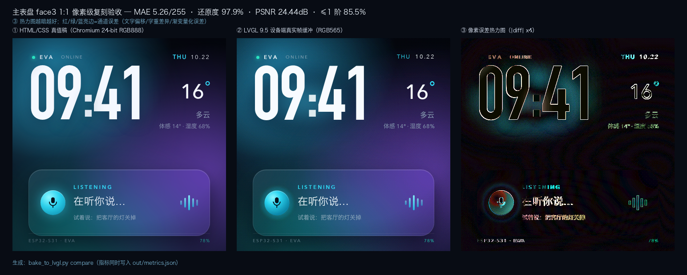
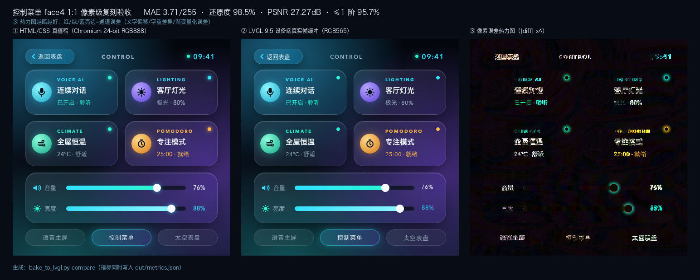
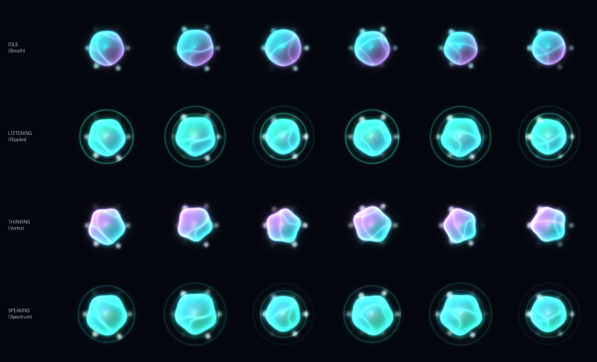

# esp32-ui-design

**无设计师的 ESP32/LVGL 界面美术与 1:1 上屏工作流**：AI 用 HTML/CSS 出设计稿 → Chromium 渲染视觉真值 → `?mode=bake_bg` 分层烘焙 → RGB565 Bayer 抖动 → 同源字重 4bpp 字库 → 宿主机真实 LVGL 帧缓冲验真 → 设备端 mmap 零拷贝 + 局部脏区刷新。

这是本工作流的**唯一真源仓库**（替代早期的 `ai-art-pipeline` 技能副本）。固件工程（`esp32/s31_smooth_demo`）在宿主项目里，本仓库只提供技能、模板、脚本与风格规范。

## 安装

```bash
git clone https://github.com/Minokun/esp32-ui-design.git ~/Desktop/workspace/ai-builder/esp32-ui-design
cd ~/Desktop/workspace/ai-builder/esp32-ui-design
./scripts/install_skill.sh          # 软链到 ~/.dsh/skills/esp32-ui-design
```

依赖：Python 3.10+（numpy/Pillow）、Node + Playwright（`npm i -g playwright && npx playwright install chromium`）、ffmpeg（可选）。

## 三条命令跑完一次设计改动

```bash
cd ~/.dsh/skills/esp32-ui-design
export EVA_PROJECT_ROOT=/path/to/edge_voice_assistant   # 固件工程根目录

./scripts/bake_to_lvgl.py build       # ① 真值 + 烘焙底图 + RGB565 资产 + 字库
./scripts/host_render.sh out          # ② 宿主机真实 LVGL 帧缓冲（秒级）
./scripts/bake_to_lvgl.py compare     # ③ 每页三联看板 + metrics.json + MAE 门禁
```

- `build --dry-run` 可在干净目录跑（临时渲染到 `/tmp`，不写仓库）；
- `compare` 输出 `out/<page>_html_vs_lvgl_1to1.png`（真值 / LVGL / |diff|×4 热力图）与 `out/metrics.json`（MAE/PSNR/逐区域差分墨迹框 dx-dy/门禁）；
- MAE > 12/255 时 `compare` 返回非 0，禁止上板；按 `metrics.json.regions` 的 dx/dy 修固件 `lvgl_ui.c` 坐标即可收敛到 0。

## 效果

主表盘 1:1（真值 / LVGL 真机帧缓冲 / `|diff|×4` 热力图）：



控制菜单 1:1：



四态语音能量球（NumPy Shader 烘焙）：



## 管线

| 阶段 | 工具 | 产物 |
|---|---|---|
| ① 视觉真值 | `templates/*.html` + Chromium | `out/screen_*.png`（480×480 RGB888） |
| ② 分层烘焙 | Chromium `?mode=bake_bg`（`bake_to_lvgl.py build` 内部） | `out/*_baked_bg.png`（与真值同源，背景 MAE=0） |
| ③ 量化 + 字库 | `bake_to_lvgl.py` | `eva_face3.bin`（EVA4）+ `ui_font_eva_pack.c`（4bpp） |
| ④ 1:1 验真 | `host_render.sh` + `bake_to_lvgl.py compare` | 真实 RGB565 帧缓冲 + 看板 + metrics + 门禁 |
| ⑤ 上板 | 宿主项目的 `flash_menu_ui.sh` | `eva` 分区 mmap + 局部脏区刷新 |

## 目录

```
templates/     设计稿模板（480×480，支持 ?mode=bake_bg / ?shape=circle / ?debug=safe_area）
scripts/       渲染/烘焙/量化/字库/验真/打包/图标/生成图视频
style_bible.md 风格唯一真源（色板/字阶/提示词/验收清单）
SKILL.md       DSH 技能入口（name: esp32-ui-design）
out/           产物目录（git 忽略，运行时生成）
```

## 实测基线（ESP32-S31，2026-10）

- 1:1 复刻：主表盘 MAE **5.27/255（97.94%）**、控制菜单 **3.71/255（98.55%）**，逐区域文字偏移 0 px；
- 设备端（2026-10-23 实机复测）：渲染循环 **~26ms**、refr 9.5~13.6ms、flush **7,968~8,024px/帧**、全屏 memcpy 10→**2.1ms**；动画节拍 40→**24ms** + 1Hz 文本变更缓存后，动画 **27~33fps（均值≈29~30）**，周期性刷新尖峰清零。

## 授权注意

脚本会读取 macOS 系统字体（DIN Condensed/Avenir Next/Hiragino Sans GB）做本地验证；**固件量产发布前必须替换为可商用字体**（可用 `EVA_FONT_*` 环境变量指向自有字体）。

## License

MIT
